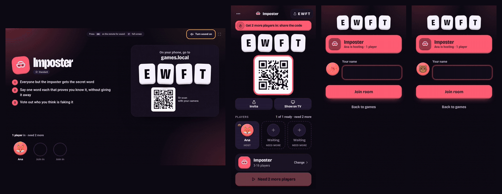

# Party Games

Free party and drinking games for adults in the same room, played on your phones with no app and no sign-up.

Run your own copy with one command.



A real round, recorded by [`scripts/demo-gif.mjs`](scripts/demo-gif.mjs).

## Try it now

One person picks a game and taps Play on everyone's phones. Everyone else scans the QR code or types the four letter code, adds a name and they are in. Open `/tv/CODE` on a TV or laptop for the big screen.

Only one phone between you? Tap Pass one phone round. It runs in the browser and works offline once loaded over https.

## Run your own

You need Node 20 or newer.

```sh
npx github:kd-011/party-games
```

The terminal prints an address and a QR code, and anyone on your wifi can open it. In my test, from an empty npm cache, it was serving about five seconds after the 7 MB download.

Docker, reverse proxies and settings are in [docs/SELF-HOSTING.md](docs/SELF-HOSTING.md).

## What is in it

Fifteen games: Imposter, Celebrity Heads, Never Have I Ever, Most Likely To, Would You Rather, Truth or Dare, Quiz Show, Fake Out, Sketchy, Codewords, Spyfall, Werewolf, Paranoia, Salad Bowl and Tune In.

Each has three tiers: Standard keeps points, Drinking adds sips, Deadly adds the odd shot with a per-player cap the host sets. String several into a Party Night and scores carry across, with awards at the end.

There are no accounts, no ads and no database. Rooms live in memory and vanish when everyone leaves or the server restarts.

This is for adults (18+). The app asks for an 18+ confirmation when someone picks or joins a drinking tier, some prompts have adult themes, and anyone can tap I'm out and take forfeits in place of drinks.

## When not to use this

- With kids. Standard has no drinking, but the prompts are written for adults.
- When you want Jackbox polish: professional writers and voice acting.
- When you want one game done deeply. [Scribble.rs](https://github.com/scribble-rs/scribble.rs) is a self-hostable draw and guess with years of use behind it.
- For friends in different places. It assumes you can hear each other.
- For a public event. It is one process holding rooms in memory, and a restart ends them.

The automated browser tests run in Chromium, so Safari gets less coverage. Casting with Show on TV has not been tried on real hardware; opening the TV address in a browser is the tested path.

## Contributing and licence

[](https://github.com/kd-011/party-games/actions/workflows/ci.yml)

Bug reports, packs and new games are welcome, see [CONTRIBUTING.md](CONTRIBUTING.md). A game is one folder, with its contract in [docs/GAME-MODULES.md](docs/GAME-MODULES.md).

MIT, see [LICENSE](LICENSE), except the Quiz Show questions (CC BY-SA 4.0) and the fonts (SIL Open Font License). Details, and a note on the name Spyfall, in [THIRD_PARTY_NOTICES.md](THIRD_PARTY_NOTICES.md).
