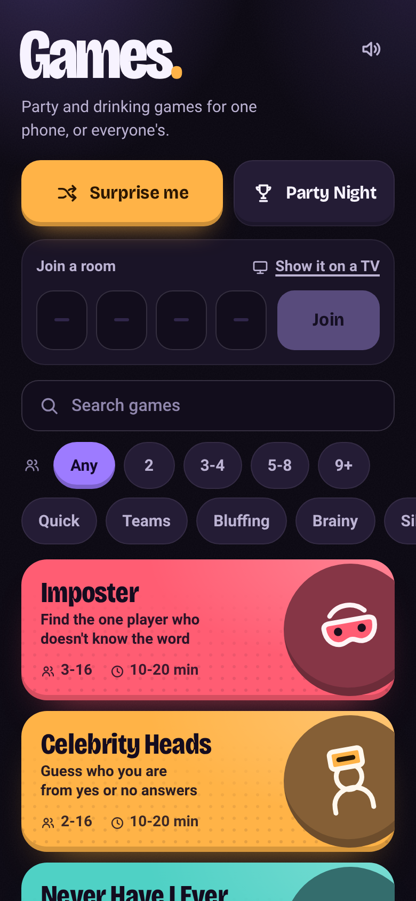
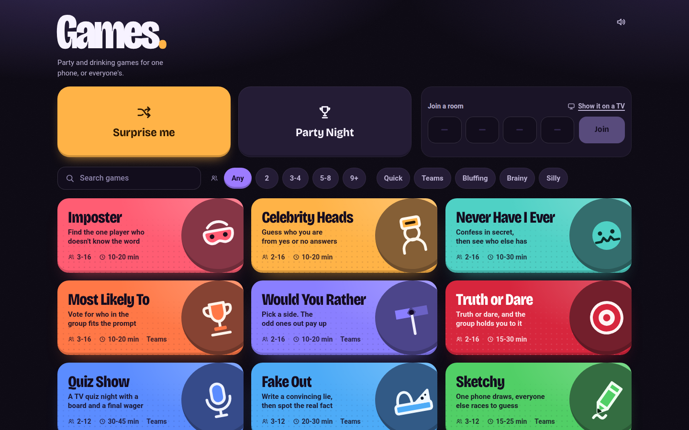
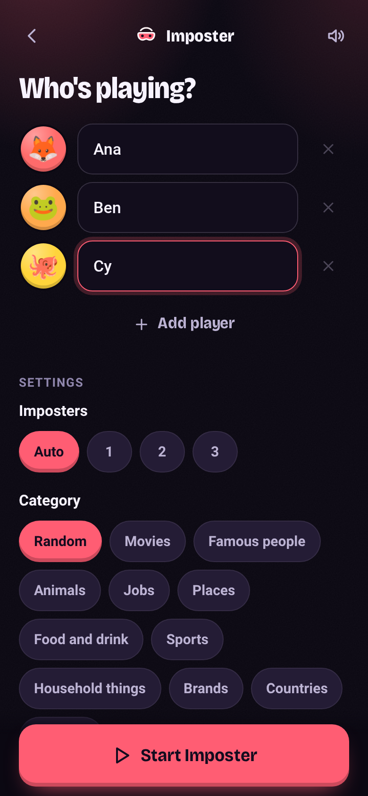
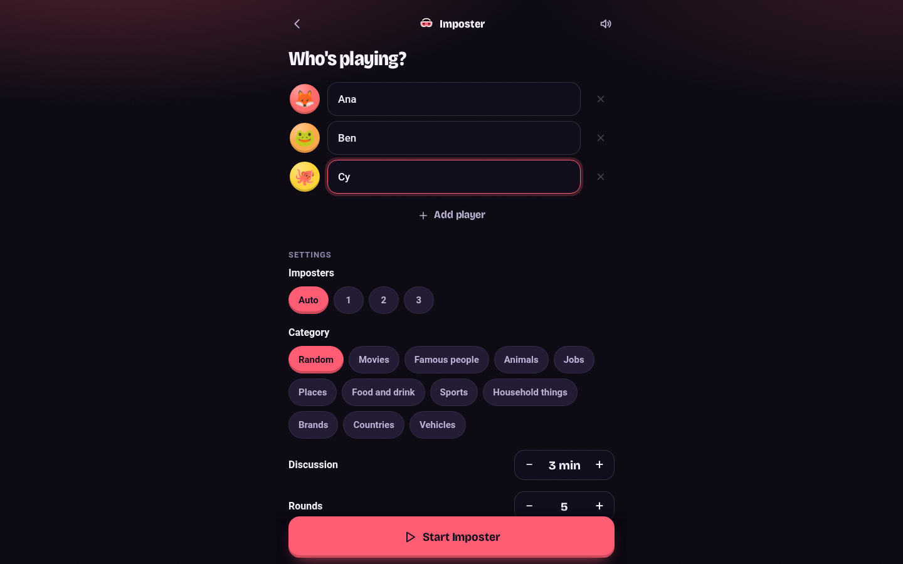

# Games

[](https://github.com/kd-011/party-games/actions/workflows/ci.yml)

Free party and drinking games for a living room. Pass one phone round, or everyone joins on their own phone with a room code and a TV screen. There are no accounts, no database and no ads.

There are fifteen games: Imposter, Celebrity Heads, Never Have I Ever, Most Likely To, Would You Rather, Truth or Dare, Quiz Show, Fake Out, Sketchy, Codewords, Spyfall, Werewolf, Paranoia, Salad Bowl and Tune In. Each has three tiers (Standard, Drinking, Deadly) and can be chained into a Party Night with a running scoreboard.

This is for adults (18+). The Drinking tier uses sips, the Deadly tier adds the odd shot, and some prompts have adult themes. The app asks for an 18+ confirmation when someone picks or joins a drinking tier, and any drink prompt can be swapped for water or a forfeit.

| Phone | Desktop |
| --- | --- |
|  |  |
|  |  |

## How to play

Any game can be played two ways.

- On one phone: pick a game, type the names and pass the phone round. Everything stays in the browser, so it works offline once the page has loaded.
- On their own phones: one person hosts a room and gets a four letter code and a QR code. Everyone else joins at the site with the code or scans the QR. Open `/tv/CODE` on a TV or laptop for the big shared screen. Rooms live in the server's memory and vanish when everyone leaves, after three idle hours, or on restart.

Each game has a short rules page in the app and a crawlable one at `/games/<id>`. Both come from `games/<id>/rules.md`.

## Quick start

You need Node 22, which is what it is developed and tested on. There is nothing to build.

```sh
git clone <this repo>
cd games
npm install
npm start
```

Then open http://127.0.0.1:8969. The server only listens on localhost by default, so to try own-phone rooms on your network put a reverse proxy in front (see Deploy).

## Configuration

Every setting is optional. Set these in the environment or in a `.env` file next to `server.mjs` (see `.env.example`).

| Variable | Default | What it does |
| --- | --- | --- |
| `GAMES_PORT` | `8969` | Port to listen on. |
| `GAMES_HOST` | `127.0.0.1` | Address to bind. Use `0.0.0.0` in a container. |
| `GAMES_SITE_URL` | read from each request's `Host` header | Public URL, no trailing slash. Used for canonical links, the sitemap, share cards and QR codes. |
| `GAMES_CONTACT_EMAIL` | `games@example.com` | Shown on the privacy and credits pages. Set this to your own if you host a copy. |
| `GAMES_PACKS_DIR` | `~/.local/share/games-packs` | Where custom and AI-made packs are saved. |
| `OPENROUTER_API_KEY` | unset | Turns on the AI pack maker. Without it the feature reports itself unavailable. |
| `GAMES_AI_PACK_MODEL` | `google/gemini-3.8-flash` | OpenRouter model for AI packs. |
| `GAMES_AI_PACK_DAILY_CAP_USD` | `0.5` | Hard daily spend cap for AI packs. |
| `GAMES_AI_REFERER` | none | Sent to OpenRouter as `HTTP-Referer` when set. |
| `KOKORO_SERVER_URL` | `http://127.0.0.1:8124` | Optional Kokoro TTS server for the Host Box voice. Silent if unreachable. |
| `HOSTBOX_VOICE`, `HOSTBOX_VOICE_SPEED` | `af_sky`, `1.0` | Voice and speed for that server. |

Development only, never in production: `GAMES_EXAMPLE=1` lists the High Card example game, `GAMES_TEST_HOOKS=1` enables the `/__test/` hooks used by the QA matrix, and `GAMES_CANARY_URL` is the target of `npm run canary`.

## Deploy

Games is one Node process: a plain `http` server plus a WebSocket endpoint at `/ws`. Plain static hosting will not run it, because rooms need the WebSocket and the server builds the game list, rules pages, sitemap and QR codes.

1. Run `node server.mjs` under whatever supervises processes on your host (systemd, Docker, a PaaS). Set `GAMES_HOST=0.0.0.0` in a container.
2. Put a TLS reverse proxy in front (Caddy, nginx, Cloudflare Tunnel). It must pass WebSocket upgrades on `/ws` and forward the `Host` header unchanged.
3. Set `GAMES_SITE_URL` if the proxy rewrites `Host`, and `GAMES_CONTACT_EMAIL` to your own address.
4. Rate limits key on the `CF-Connecting-IP` header, falling back to the socket address. Behind a proxy that is not Cloudflare, have it set that header, or every visitor shares one limit. Never expose the Node port directly to the internet, since that header can then be spoofed.

State is in memory, so run exactly one instance, and expect a restart to end open rooms.

## Tests

```sh
npm test            # unit and contract tests, no browser needed
npm run e2e         # plays every game in a real browser (needs a Chromium for Playwright)
```

## Contributing

Bug reports, new packs and new games are welcome, see `CONTRIBUTING.md`. A game is one self-contained folder, and its contract is in `docs/GAME-MODULES.md`.

## Licence

MIT, see `LICENSE`. Two things are not MIT. The Quiz Show question file `games/quiz-show/content.json` is largely from the Open Trivia Database and stays CC BY-SA 4.0, and the bundled fonts use the SIL Open Font License. Details in `THIRD_PARTY_NOTICES.md`.

"Spyfall" is also the name of a commercial board game. This project uses the name descriptively for a similar idea. If you publish your own build under a product name, pick your own.
