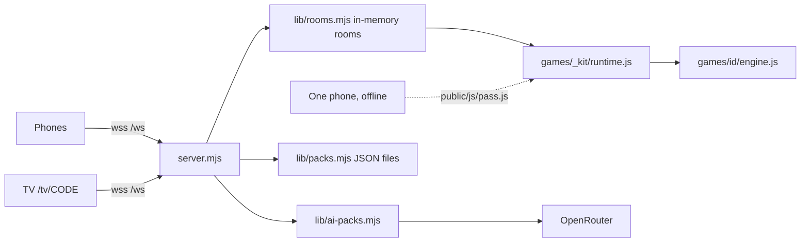

# Games: how it is built

One Node process: a plain `node:http` server plus a `ws` WebSocket endpoint at `/ws`, serving vanilla ES module JavaScript with no build step and no database. Each game is a pure, isomorphic engine that runs on the server for rooms and in the browser for pass and play, so the two modes cannot drift. Runtime dependencies are `ws` and `qrcode-generator` only. <!-- src: server.mjs:1-15, package.json#dependencies, games/_kit/runtime.js:1-4 -->

## Components

- `server.mjs`: HTTP routes, static files, the per-game rules pages, sitemap, QR SVGs, `/healthz`, the packs API and the WebSocket upgrade. <!-- src: server.mjs:337-447, server.mjs:449-509 -->
- `lib/rooms.mjs`: the RoomManager. Transport-agnostic (a connection is any object with `send` and `close`), server-authoritative, in-memory; its header documents the whole wire protocol. <!-- src: lib/rooms.mjs:1-55 -->
- `lib/registry.mjs`: discovers every `games/<id>/` folder at start-up and validates its engine, client, rules and packs. <!-- src: lib/registry.mjs:1-13, lib/registry.mjs:60-62 -->
- `games/_kit/`: shared isomorphic code. `runtime.js` is the one place that drives an engine; `drinks.js` is the drink engine; `night.js` keeps Party Night; `kit.js` and `palette.js` are helpers for engines. <!-- src: games/_kit/runtime.js:1-4, games/_kit/drinks.js:1-3, games/_kit/night.js:1-5, games/_kit/kit.js:1-4 -->
- `games/<id>/`: one folder per game, `engine.js` (state machine), `client.js` (renders views to HTML strings), `rules.md`, optional `content.json`, `packs/`, `icon.svg`, `style.css`. Contract: docs/GAME-MODULES.md. <!-- src: docs/GAME-MODULES.md:20-31 -->
- `public/`: the app shell (`index.html`), `js/` modules (router in `app.js`, rooms in `room.js`, the TV in `tv.js`, the socket client in `net.js`, pass and play in `pass.js`, rendering in `surface.js`), `style.css`, the vendored ui-kit in `kit/`, the service worker and the static pages. <!-- src: public/js/app.js:1-2, public/js/room.js:1-2, public/js/tv.js:1-2, public/js/net.js:1-3, public/js/pass.js:1-2, public/js/surface.js:1-3, public/kit/kit.css:1-3 -->
- `lib/packs.mjs`, `lib/curated.mjs`, `lib/ai-packs.mjs`, `lib/profanity.mjs`, `lib/ratelimit.mjs`: custom, curated and AI packs, the profanity gate and an in-memory sliding-window limiter. <!-- src: lib/packs.mjs:1-6, lib/curated.mjs:1-11, lib/ai-packs.mjs:1-5, lib/profanity.mjs:1-5, lib/ratelimit.mjs:1-4 -->
- `lib/hostbox.mjs`, `lib/voice.mjs`, `lib/tts.mjs`: the Host Box's pure pairing and button logic, its templated voice lines and a Kokoro TTS client. <!-- src: lib/hostbox.mjs:1-5, lib/voice.mjs:1-5, lib/tts.mjs:1-7 -->
- `lib/lan.mjs` and `bin/couchbox.mjs`: the one-command local-network start. <!-- src: lib/lan.mjs:1-2, bin/couchbox.mjs:1-10 -->
- `lib/plays.mjs`: parses the `[rooms]` journal lines into a per-game summary. `lib/testhooks.mjs`: QA-only state hooks. <!-- src: lib/plays.mjs:1-12, lib/testhooks.mjs:1-6 -->
- `scripts/export-public.mjs` and `scripts/secret-scan.mjs`: publish a scrubbed copy of the repo to the public GitHub repository. <!-- src: scripts/export-public.mjs:1-23 -->

## Data flow

- Room: a phone opens `/ws` (same-origin check, 32 KB message cap, 30 sockets per client IP, 4000 in total), sends `create` or `join`, and `lib/rooms.mjs` runs each `act` through `runtime.js`. Every player then gets `{ t:'state' }` with only their own view, and each TV gets `{ t:'tv' }` with the public view. <!-- src: server.mjs:453-478, lib/rooms.mjs:7-40 -->
- The runtime clones state per action and rolls back a rejected one, so a bad action leaves the game untouched. <!-- src: games/_kit/runtime.js:76-84 -->
- Each socket is rate limited by a token bucket (20 messages a second, bursts of 40), and pings every 20 seconds drop dead connections, which starts host failover after a 30 second grace. <!-- src: lib/rooms.mjs:198-206, server.mjs:501-509, lib/rooms.mjs:112 -->
- Pass and play: `public/js/pass.js` drives the same engine locally and shows a hide-and-pass screen whenever the engine's `passTurn` says someone needs a private look. <!-- src: public/js/pass.js:1-4 -->
- Packs: `POST /api/packs` and `POST /api/packs/ai` take size-capped JSON bodies (80 KB and 4 KB); `GET /api/packs/<code>` returns one pack. It is the only JSON API; every other route is GET or HEAD. <!-- src: server.mjs:121-150, server.mjs:344-350 -->
- Static: HTML and text pages get `{{origin}}`, `{{host}}` and `{{contact}}` filled per request, so no domain is hard-coded. The origin is `GAMES_SITE_URL`, else the request's `Host` header. <!-- src: server.mjs:176-180, server.mjs:201-207 -->
- The service worker precaches the shell and every game's files and serves network-first, so a deploy is picked up on the next load and one-phone play works offline. <!-- src: public/sw.js:1-4 -->

## Storage

- Rooms: process memory only. A room closes 15 minutes after the last socket leaves, after 3 hours idle, or on restart; at most 2000 rooms. <!-- src: lib/rooms.mjs:112-115, server.mjs:95 -->
- Browser localStorage: the pass-and-play game, player name, rejoin token, last game, tier and the 18+ flags. <!-- src: public/js/pass.js:24-34, public/js/app.js:439-443, public/js/room.js:24-36, public/js/ui.js:372-375 -->
- Custom and AI packs: one JSON file per pack under `GAMES_PACKS_DIR` (default `~/.local/share/games-packs`), outside the repo, plus `ai-pack-spend.json` for the daily cap. <!-- src: server.mjs:77-85, lib/packs.mjs:1-6 -->
- Host Box voice clips: cached WAV files under `data/hostbox-voice/`, keyed by a hash of the text. <!-- src: server.mjs:74-75, lib/tts.mjs:1-4 -->
- Logs: `[rooms]`, `[packs]` and `[ai-packs]` lines on stdout, with no names or IP addresses. <!-- src: docs/TELEMETRY.md:1-5, public/privacy.html:20-25 -->

## Auth

No login and no accounts: every route is public. A room code is low-trust by design; a rejoin token held in the browser lets a player reclaim their seat. The Host Box is trusted only after the room's host pairs it. <!-- src: server.mjs:67-69, lib/rooms.mjs:339-341, lib/rooms.mjs:383-386, docs/HOSTBOX-PROTOCOL.md:13 -->

## External services

- OpenRouter chat completions for the AI pack maker: `OPENROUTER_API_KEY`, `GAMES_AI_PACK_MODEL`, `GAMES_AI_PACK_DAILY_CAP_USD`, `GAMES_AI_REFERER`. <!-- src: lib/ai-packs.mjs:11, .env.example:19-24 -->
- Kokoro TTS for the Host Box voice, optional: `KOKORO_SERVER_URL`, `HOSTBOX_VOICE`, `HOSTBOX_VOICE_SPEED`. <!-- src: lib/tts.mjs:1-7, .env.example:26-29 -->

## Unverified

- The production host and its TLS proxy are configured outside this repo.
